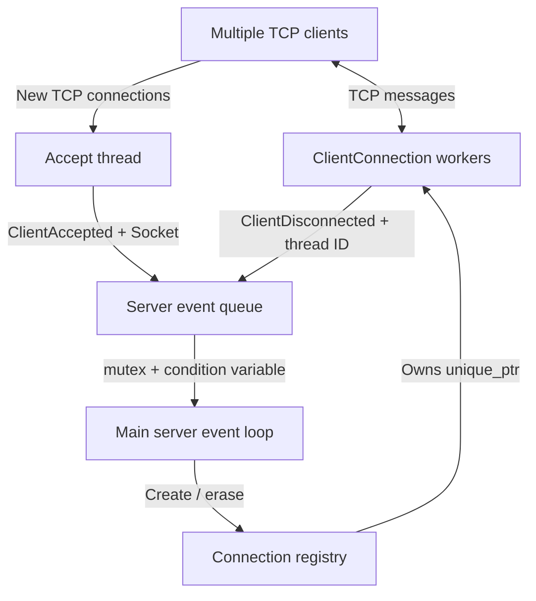
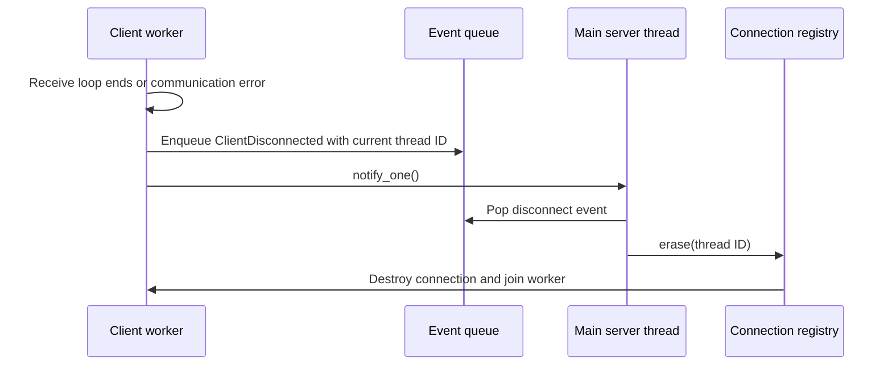

# C++ Networking — Multithreaded TCP Client/Server

A hands-on C++ systems programming project exploring TCP networking, resource ownership, concurrency and scalable server architecture. The current implementation is a multithreaded TCP echo server with an event-driven connection lifecycle. The longer-term goal is to evolve it into a simulated financial exchange and trading platform, with measurable performance characteristics.

## Current status

The project currently supports concurrent client connections, framed application messages, blocking I/O, synchronized event delivery and automatic removal of disconnected clients. It is an educational engineering project under active development, not a production-ready trading system.

- TCP client/server communication using socket abstractions.
- Move-only socket ownership and RAII-based resource management.
- A dedicated accept thread and one worker thread per client.
- A central server event loop using a thread-safe access pattern around a standard queue.
- Callback-based notification of client disconnection.
- Automatic cleanup of completed client connections.
- Echo responses using a separate application-level message protocol.
- Blocking waits instead of idle polling.

## Architecture



The server separates accepting connections, handling client traffic and managing connection ownership. The main thread is the sole owner and modifier of the connection registry; background threads communicate lifecycle events through the shared queue rather than modifying the registry directly.

### Threading model

| Thread | Responsibility | Blocking operation |
| --- | --- | --- |
| Main server thread | Consume lifecycle events, create and remove client connections | `condition_variable::wait()` |
| Accept thread | Accept incoming TCP connections and publish acceptance events | `accept()` through `Socket::Accept()` |
| Client worker (one per connection) | Receive messages, send echo responses and report completion | Blocking receive through `ReceiveMessage()` |

This design is intentionally straightforward. It allows the implementation to focus on correctness and ownership before introducing non-blocking sockets or I/O multiplexing. Its main scalability limitation is the resource cost of dedicating a thread to every client.

## Components

| Component | Responsibility |
| --- | --- |
| `TcpServer` | Bind and listen, start the accept thread, consume events and maintain active connections. |
| `TcpServerEvent` | Represent connection acceptance and disconnection events with typed payloads. |
| `ClientConnection` | Own an accepted socket, a disconnect callback and the worker thread servicing that connection. |
| `Socket` | Socket abstraction used to transfer ownership and encapsulate socket operations. |
| `Thread` | RAII thread abstraction used for worker and accept threads. |
| `NetworkRuntime` | Network runtime object owned by the server, constructed before the listening socket. |
| `MessageProtocol` | Application-level `SendMessage()` and `ReceiveMessage()` interface, separate from connection management. |
| `main.cpp` | Create the server at `127.0.0.1:9000` and start its event loop. |

The server implementation resides in `TcpServer.h/.cpp`, `ClientConnection.h/.cpp` and `main.cpp`. Shared networking and protocol abstractions are separate dependencies.

## Connection lifecycle

### Accepting a client

1. The accept thread blocks until a TCP client connects.
2. The accepted socket is moved into a `TcpServerEvent` of type `eClientAccepted`.
3. The event is pushed into `serverEvents` while holding `eventsMutex`.
4. The mutex is released and `eventsCondition.notify_one()` wakes the consumer if necessary.
5. The main thread removes the event from the queue, releases the mutex and constructs a `ClientConnection`.
6. The connection is registered in `clientConnections`, an `unordered_map` keyed by `std::thread::id` and owning `std::unique_ptr<ClientConnection>` values.

### Handling messages

Each connection has its own worker thread. It repeatedly calls `networking::protocol::ReceiveMessage()` and, when a message is available, sends it back through `networking::protocol::SendMessage()`. A missing message ends the loop; a caught `std::exception` is logged and also leads to completion notification.

TCP provides an ordered byte stream rather than application message boundaries. The separate message protocol is responsible for preserving those boundaries; the server's business logic operates on messages instead of individual receive operations.

### Disconnecting a client



The callback is injected by `TcpServer` when the connection is constructed. `ClientConnection` does not need a direct dependency on `TcpServer` or its synchronization objects.

The callback publishes the ID returned by `std::this_thread::get_id()`, avoiding access to the thread wrapper from the worker during its construction. Destruction is handled by the main thread, avoiding an attempt by a worker to join itself.

## Concurrency and synchronization

The shared event queue implements a multiple-producer, single-consumer pattern. The accept thread and client workers publish events, while the main thread consumes them.

The consumer uses the following synchronization pattern:

```cpp
std::unique_lock lock(eventsMutex);

while (serverEvents.empty())
{
    eventsCondition.wait(lock);
}

serverEvent = std::move(serverEvents.front());
serverEvents.pop();
```

- The queue is accessed under a common mutex.
- `wait()` atomically releases the mutex and enters the waiting state, allowing producers to acquire the mutex.
- The mutex is reacquired before `wait()` returns.
- The loop rechecks the queue to handle spurious wakeups.
- Producers store the event before notifying the consumer; notifications themselves are not persistent, but queued events are.
- Connection creation and destruction occur outside the queue's critical section.

An earlier implementation repeatedly polled the queue, resulting in unnecessary CPU usage. Replacing polling with a condition variable reduced observed idle CPU utilization from approximately 24% to 0% in a local manual test. This is an informal observation, not a controlled benchmark.

## Ownership and lifetime management

The project uses RAII and explicit ownership transfer as core design principles.

- Accepted sockets are moved from the accept thread into events and then into client connection objects.
- The connection registry owns connection objects through `std::unique_ptr`.
- `ClientConnection` is neither copyable nor movable, keeping its address stable while the worker captures `this`.
- The socket and disconnect callback are declared before the worker thread, ensuring they are initialized before the worker starts.
- Members are destroyed in reverse declaration order, so the RAII thread wrapper is destroyed before the callback and socket.
- Erasing a registry entry destroys the owned connection rather than leaving an empty smart pointer in the registry.

The event structure uses an enum and optional payloads rather than a dynamically allocated polymorphic hierarchy:

| Event | Payload |
| --- | --- |
| `eClientAccepted` | `std::optional<Socket>` containing the accepted socket |
| `eClientDisconnected` | `std::optional<std::thread::id>` containing the completed worker ID |

The explicit converting constructors initialize the appropriate event type and payload. The current default constructor is used for the consumer's temporary event, which is assigned before inspection.

## Running and testing

The current server entry point binds to the loopback interface on TCP port `9000`. Start the server executable built from the full project, then start one or more compatible client executables and send messages. The server echoes each message back to its originating client.

The protocol-aware client should be used for testing rather than assuming raw text sent with a generic TCP tool is a valid application message.

Exact build commands and dependencies are not documented here because the complete build configuration and shared source files were not included in the server snapshot used to prepare this README.

### Manual verification

- Connect a client and verify its echo response.
- Connect multiple clients and verify that each can communicate independently.
- Disconnect clients individually and verify that their connection objects are removed.
- Leave the server idle and verify that CPU utilization remains near zero.
- Connect and disconnect repeatedly to exercise event delivery and resource cleanup.

Concurrent client communication, disconnect cleanup and idle waiting have been manually exercised during development. Automated tests and systematic stress tests are planned.

## Current limitations

- No coordinated graceful shutdown yet: the accept loop and server event loop run indefinitely, and workers may block in receive operations.
- One thread per connection limits scalability for large numbers of concurrent clients.
- Comprehensive handling of accept failures, transport errors and shutdown races remains to be implemented.
- The event payload invariant is not enforced by the type system because the fields are public.
- No production security, authentication, TLS or trading functionality is implemented at this stage.
- No controlled latency, throughput or resource-usage benchmarks are available yet.

## Roadmap

### 1. Complete the TCP foundation

- [x] TCP echo communication and application-level message framing
- [x] RAII resource ownership
- [x] Concurrent client handling
- [x] Blocking producer–consumer event loop
- [x] Connection cleanup through disconnect callbacks
- [ ] Graceful shutdown: stop accepting, interrupt blocking I/O, finish workers and release resources
- [ ] Socket options and robust error handling (`SO_REUSEADDR`, `TCP_NODELAY`)
- [ ] Automated protocol and lifecycle tests

### 2. Explore networking and scalable I/O

- [ ] Inspect TCP handshakes, retransmissions and connection states using Wireshark or tcpdump
- [ ] UDP unicast and multicast communication
- [ ] Non-blocking sockets and I/O multiplexing (`select`, `poll`, Linux `epoll`)
- [ ] Compare thread-per-client and event-driven I/O models
- [ ] Load testing, latency distributions, throughput and resource measurements

### 3. Evolve into a simulated financial exchange

- [ ] Define a binary trading protocol and order lifecycle
- [ ] Implement an order book and matching engine
- [ ] Publish market data and trade updates
- [ ] Support reconnect and state synchronization
- [ ] Explore transaction journaling, deterministic replay and recovery
- [ ] Add basic simulated risk controls
- [ ] Optionally consume public exchange market data without placing real orders

### 4. Visualization and performance engineering

- [ ] Qt client for visualizing orders, trades and market data
- [ ] Profile allocation overhead, contention and cache locality
- [ ] Compare optimization approaches against reproducible benchmarks

## Engineering objectives

The project emphasizes understanding the trade-offs behind each implementation rather than adopting complexity prematurely. It provides a practical foundation for modern C++, TCP/IP networking, Linux systems programming, concurrent software design and performance engineering.
